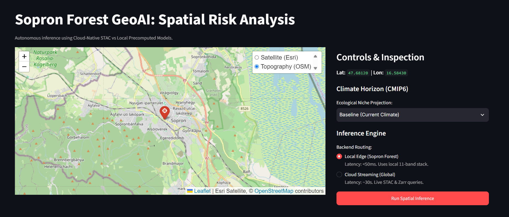
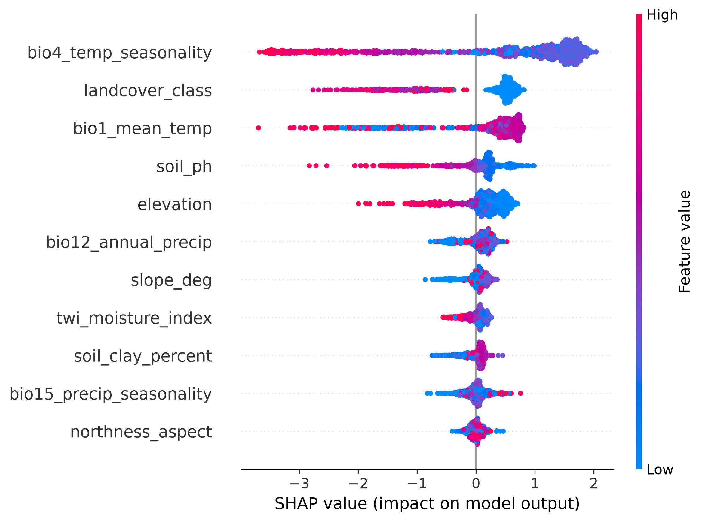

# Armillaria Pathogen Risk Assessment Pipeline (GeoAI SDM)

[](https://github.com/DanilKras/ArmillariaGeoAIPipeline/actions/workflows/ci.yml/badge.svg)
[](https://www.python.org/)
[](https://dvc.org/)
[](LICENSE)

An end-to-end, configuration-driven Geospatial Machine Learning pipeline designed to model, explain, and project the spatial infection risk of *Armillaria ostoyae* across forest ecosystems, centered on the Sopron / Lake Fertő region (Hungary).

The system integrates macro-scale Species Distribution Modeling (SDM) with micro-scale UAV/LiDAR canopy monitoring, utilizing cloud-native STAC catalogs, multi-dimensional Zarr stores, and spatial cross-validation to resolve spatial autocorrelation.

---

## Interactive Dashboard & Inference Demo

| Real-Time Spatial Risk & SHAP Attribution | Global Factor Attribution (SHAP Beeswarm) |
| :---: | :---: |
|  |  |

> 🔗 **Video Walkthrough:** [Project Demonstration Video](https://drive.google.com/file/d/1qoOQKh6-J5Bo6bT5EiugL-U74ZHSM_zP/view?usp=sharing)

---

## Key Achievements & Performance

- **Mean Spatial ROC-AUC: 0.955 ± 0.017** on 5-fold Spatial GroupKFold Cross-Validation (150 km spatial block buffers), proving generalization without geographical data leakage.
- **Dual-Engine Inference Backend:** 
  - **Local Edge Engine:** Zero-latency sub-50ms inference via local precomputed 11-band GeoTIFF stacks.
  - **Cloud-Native Streaming Engine:** Serverless on-demand sampling via STAC APIs (Copernicus DEM, ESA WorldCover) and asynchronous Zarr temporal slicing (TerraClimate).
- **Single Source of Truth (SSOT):** Centralized dynamic pipeline orchestration through `config.yaml`.
- **CMIP6 Climate Scenarios:** Spatial risk shifts evaluated under SSP2-4.5 and SSP5-8.5 projection horizons (2050).

---

## 11 Ecological Predictors

| Domain | Predictor Variable | Source / Resolution | Ecological Relevance |
| :--- | :--- | :--- | :--- |
| **Topography** | Elevation (m) | Copernicus GLO-30 (30 m) | Bioclimatic lapse rates & vertical zonation |
| | Slope (°) | Computed from DEM 3x3 kernel | Surface water runoff & erosion regimes |
| | Northness (Aspect) | $\cos(\text{aspect}_\text{rad})$ | Solar radiation, shade, and microclimate |
| | Topographic Wetness Index (TWI) | $\ln(\alpha / \tan \beta)$ | Moisture accumulation in micro-depressions |
| **Land Cover** | Land Cover Class | ESA WorldCover (10 m) | Forest canopy host presence constraint (Class 10) |
| **Soil Properties**| Soil pH ($H_2O$, 0–5 cm) | ISRIC SoilGrids 2.0 (250 m) | Soil acidity; lower pH accelerates rhizomorph growth |
| | Soil Clay Content (%) | ISRIC SoilGrids 2.0 (250 m) | Soil aeration, drainage, and root asphyxiation risk |
| **Macroclimate** | Mean Annual Temp (`BIO1`) | TerraClimate Zarr (1995–2025) | Thermal niche envelope |
| | Temp Seasonality (`BIO4`) | TerraClimate Zarr (1995–2025) | Continental vs oceanic winter stress |
| | Annual Precipitation (`BIO12`)| TerraClimate Zarr (1995–2025) | Overall water availability |
| | Precip Seasonality (`BIO15`) | TerraClimate Zarr (1995–2025) | Drought vulnerability and rainfall distribution |

---

## Pipeline Architecture

```text
├── config.yaml                     # SSOT Configuration File
├── .dvc/                           # Data Version Control tracking
├── api/                            # Dual-Engine FastAPI backend
│   ├── main.py                     # Local & cloud endpoints with TreeSHAP
│   └── schemas.py                  # Pydantic validation models
├── frontend/                       # Streamlit web application
│   └── app.py                      # Interactive Leaflet map & dynamic gauge UI
├── dags/                           # Apache Airflow workflow automation
│   └── armillaria_pipeline_dag.py  # End-to-end DAG (extraction -> CV -> maps)
├── data/                           # DVC-managed data storage
│   ├── 01_raw/                     # Raw occurrences (GBIF API)
│   ├── 02_processed/               # Parquet tabular data & 1 km thinned points
│   ├── 03_results/                 # GeoTIFF risk rasters & publication figures
│   └── micro_soe/                  # Micro-scale UAV LiDAR & crown polygons
├── models/
│   └── armillaria_spatial_xgb.json # Production XGBoost model weights
├── notebooks/
│   ├── 01_eda_armillaria.ipynb     # Spatial variogram & sampling EDA
│   └── 02_micro_crown_eda.ipynb    # Tree crown allometry & orthophoto inspection
├── src/
│   ├── macro/                      # Macro-scale SDM engine
│   │   ├── data_extraction.py      # GBIF API harvester
│   │   ├── data_processing.py      # 1 km spatial rarefaction
│   │   ├── feature_extraction.py   # STAC & TerraClimate Zarr batch sampler
│   │   ├── negative_sampling.py    # KDTree balanced pseudo-absence generator
│   │   ├── model_training.py       # Spatial Block CV & XGBoost training
│   │   └── inference.py            # 11-band regional GeoTIFF exporter
│   └── micro/                      # Micro-scale UAV & LiDAR fusion
│       └── lidar_processor.py      # Point cloud & CHM extraction
└── utils/
    ├── config_loader.py            # Dynamic YAML configuration parser
    └── generate_future_risk_maps.py# CMIP6 2050 projection map generator

## Getting Started

### Prerequisites

- Python 3.12+
- `uv` (recommended) or `pip`
- Docker & Docker Compose

### 1. Environment Setup

```bash
# Clone the repository
git clone [https://github.com/DanilKras/ArmillariaGeoAIPipeline.git](https://github.com/DanilKras/ArmillariaGeoAIPipeline.git)
cd ArmillariaGeoAIPipeline

# Create virtual environment and sync dependencies
uv venv .venv
source .venv/bin/activate  # On Windows: .venv\Scripts\activate
uv sync
```

### 2. Pulling Heavy Datasets (DVC)

All heavy rasters, point clouds, and preprocessed layers are managed via DVC:

```bash
dvc pull
```

### 3. Running Services via Docker Compose

Launch the API, interactive dashboard, and Airflow orchestration cluster:

```bash
docker-compose up --build -d
```

| Service | Endpoint | Description |
| :--- | :--- | :--- |
| **Streamlit Dashboard** | [http://localhost:8501](http://localhost:8501) | Interactive Leaflet inspection & live SHAP breakdown |
| **FastAPI Swagger UI** | [http://localhost:8000/docs](http://localhost:8000/docs) | OpenAPI interactive documentation |
| **Airflow Webserver** | [http://localhost:8080](http://localhost:8080) | Pipeline execution DAG and task monitoring |

---

## Standalone Pipeline Execution

Execute the entire macro-scale workflow sequentially:

```bash
# 1. Occurrence ingestion & 1 km rarefaction
python -m src.macro.data_extraction
python -m src.macro.data_processing

# 2. Balanced pseudo-absence generation
python -m src.macro.negative_sampling

# 3. 11-feature environmental extraction (DEM, LandCover, Soil, Climate)
python -m src.macro.feature_extraction

# 4. Spatial Block CV & Model Training
python -m src.macro.model_training

# 5. Risk map & 11-band GeoTIFF stack export
python -m src.macro.inference

# 6. CMIP6 Climate Horizon Projections (2050)
python -m utils.generate_future_risk_maps
```

---

## Methodology & Validation

1. **Combating Spatial Autocorrelation:** Standard random $K$-fold cross-validation produces artificially inflated scores due to spatial proximity. We construct 150 km regular spatial blocks (`GroupKFold`) based on spatial semivariogram analysis, ensuring complete independence between training and test folds.
2. **Dynamic TreeSHAP Attribution:** Every point prediction returned by the API is decomposed into additive feature contributions in log-odds space, providing full physical interpretability for forest health inspectors.
3. **Multi-Scale GeoAI Vision:** Macro-scale habitat suitability maps ($30\text{ m}$) serve as an ecological prior ($P_\text{macro}$), gating micro-scale deep learning models operating on UAV orthophotos ($20\text{ cm}$) and LiDAR Canopy Height Models (CHM, $1\text{ m}$).

---

## License

Distributed under the [MIT License](LICENSE).